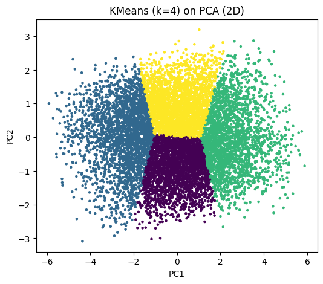
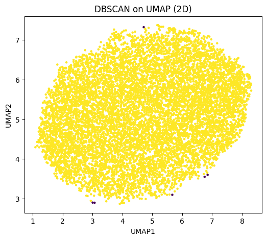
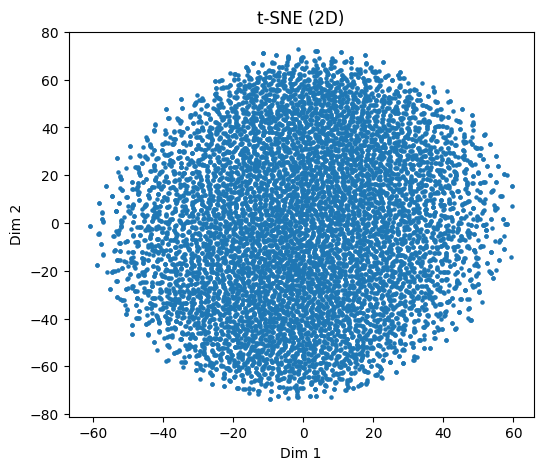

# High-Dimensional Dataset Visualisation

Exploratory analysis of a 32-dimensional aircraft wing-structure dataset, using dimensionality reduction (PCA, UMAP, t-SNE) and clustering (k-means, DBSCAN) to look for structure in the design space.

## Problem

Engineering design datasets often have many input and output variables, which makes them hard to inspect directly. The aim here is to project the data into two dimensions, see whether distinct groups of designs appear, and assess how well standard clustering methods separate them.

## Data

The notebook expects `data/wing_structure_32d.csv`: 10,001 rows and 32 numeric columns describing a wing box test configuration, including:

- geometry (root and tip chord, semi-span, wingbox height, rib positions, jack and clamp positions, strain-gauge positions)
- material and sizing (rib, skin and spar thickness, Young's modulus, Poisson's ratio)
- applied loads (four jack loads)
- responses (tip displacement, top and bottom strain)

**The dataset is not included in this repository.** To run the notebook you need your own copy of the file in `data/`.

## Approach

All steps are in [`notebooks/01_preprocessing_wing.ipynb`](notebooks/01_preprocessing_wing.ipynb).

1. **Preprocessing**
   - Checked for missing values (none) and duplicate rows (none).
   - Removed outliers with a z-score filter, keeping rows where every feature has |z| < 3 (10,001 to 9,987 rows).
   - Standardised all features with `StandardScaler`.
2. **Dimensionality reduction** to two dimensions with:
   - PCA
   - UMAP (`n_neighbors=15`, `min_dist=0.1`)
   - t-SNE (`perplexity=30`)
3. **Clustering**
   - k-means (k = 4) on the 2D PCA projection, scored with the silhouette coefficient.
   - DBSCAN (`eps=0.2`, `min_samples=20`) on the 2D UMAP projection.

## Findings

- **PCA captures little of the variance in two dimensions.** PC1 and PC2 explain 12.1% and 3.3% of the variance (15.4% together), so most of the variation is spread across many directions.
- **No clear natural clusters.** The PCA, UMAP and t-SNE projections each show a single continuous cloud of points rather than separate groups.
- **k-means (k = 4) on PCA** gives a silhouette score of 0.36. Because the data form one continuous cloud, this mainly reflects k-means partitioning that cloud rather than recovering distinct groups. k = 4 was chosen as an example, not tuned.
- **DBSCAN on UMAP** finds a single cluster plus a handful of noise points, which agrees with the projections.

These results suggest the samples cover the design space fairly evenly, without distinct design families. This is an early exploratory notebook; next steps could include choosing k systematically, using more PCA components before clustering, and relating the projections to the response variables.

| k-means (k = 4) on PCA | DBSCAN on UMAP | t-SNE |
|---|---|---|
|  |  |  |

## Running the notebook

Requires Python 3.10 or later (developed with 3.12).

```bash
python -m venv venv
source venv/bin/activate          # Windows: venv\Scripts\activate
pip install -r requirements.txt jupyter

# Place wing_structure_32d.csv in data/
jupyter notebook notebooks/01_preprocessing_wing.ipynb
```

Run the notebook from the `notebooks/` folder: it reads `../data/wing_structure_32d.csv` and writes the 2D PCA coordinates to `../data/pca_2d_results.csv`. Both are excluded from Git by `.gitignore`.

## Tech stack

Python, pandas, NumPy, SciPy, scikit-learn, umap-learn, Matplotlib, Jupyter.

## Licence

[MIT](LICENSE) (code only).
