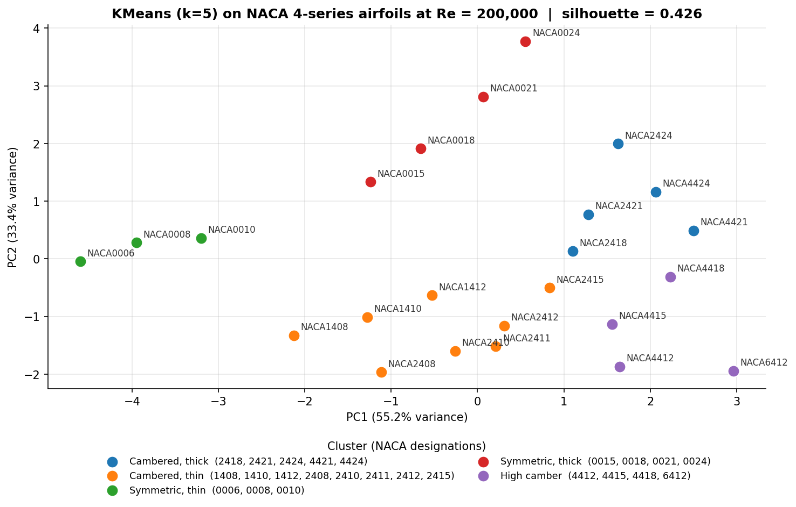
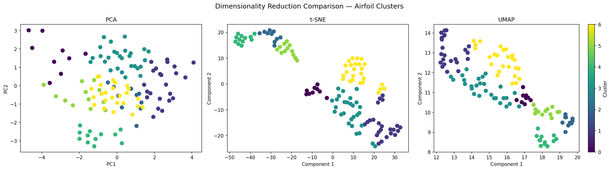
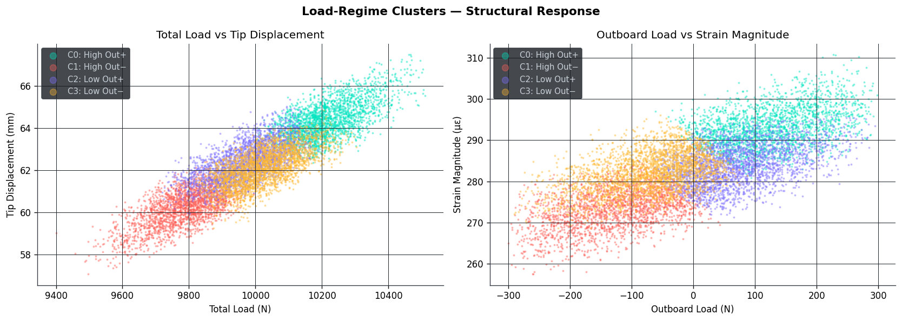
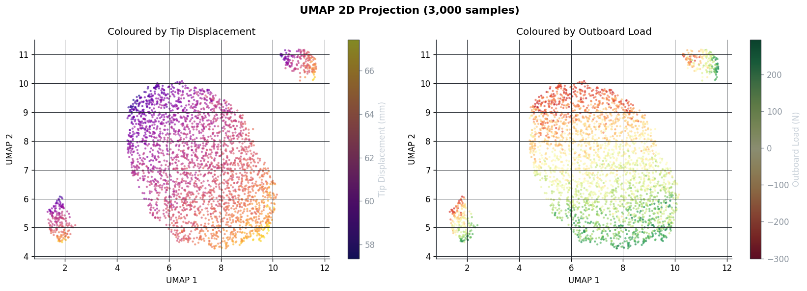
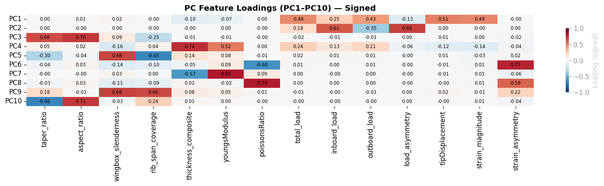
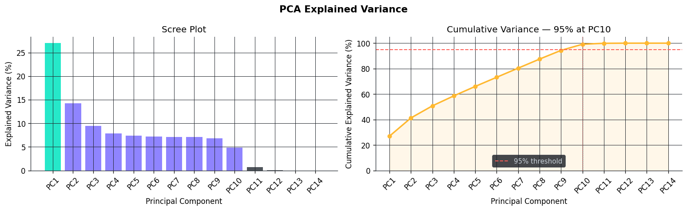

# Visualisation of High-Dimensional Aerospace Engineering Datasets

**Unsupervised machine learning (dimensionality reduction + clustering) applied to aerofoil and wing-structure data.**

BSc Computer Science dissertation project (University of Liverpool, 2025/26), carried out in collaboration with the
[Centre for Modelling & Simulation (CFMS)](https://www.cfms.org.uk/).


---

## Overview

Engineering simulation produces datasets with dozens of interacting parameters that are hard to explore by hand.
This project investigates whether unsupervised learning can surface meaningful structure in such data without
any labels or prior domain knowledge.

Two datasets were analysed:

| Dataset | Size | Description |
|---|---|---|
| **NACA 4-series aerofoils** (public, Kaggle) | 16,500 rows × 8 cols → 24 aerofoils | Lift/drag polars for 24 aerofoils across 5 Reynolds numbers |
| **CFMS wing structure** (provided by CFMS) | 10,001 rows × 32 cols | Parametric sweep of wing geometry, material, loading and structural response |

**Techniques:** PCA · t-SNE · UMAP · KMeans · DBSCAN · Agglomerative (Ward) clustering · silhouette / elbow analysis ·
domain-informed feature engineering · interactive Streamlit tools.

---

## Key findings

### 1. Clustering independently rediscovered the NACA aerofoil families

Using **only aerodynamic performance and geometry features** (no names or design lineage), KMeans grouped the
aerofoils into the same families that the NACA 4-digit naming system encodes: thin symmetric, thick symmetric,
low-camber, thick cambered, and high-camber designs.



This was **cross-verified with an independent method**: DBSCAN on the same features (visualised with UMAP) at
Re = 50,000 found the same symmetric-thin / symmetric-thick / cambered split (silhouette **0.628**), and labelled the
highly cambered aerofoils as outliers. That is aerodynamically meaningful, because high-camber sections pay large
drag penalties at low Reynolds numbers.

### 2. Reynolds number is a confounding variable

With all flow conditions pooled, the first principal component was dominated by Reynolds number rather than aerofoil
shape. Fixing Reynolds number shifted PC1 to genuine aerodynamic characteristics and raised the KMeans silhouette
score from **0.332 → 0.426**.



### 3. Pipeline ordering should depend on dataset scale

For the small NACA dataset (24 aerofoils, 7 features), **clustering in the full feature space first** gave the
best results. For the larger 32-D CFMS dataset, **reducing dimensionality first** (PCA to 10 components, keeping
95% of the variance) was necessary. The right pipeline structure depends on the data, not just on which algorithm you pick.

### 4. The CFMS design space is continuous, with four broad load regimes

The 32 raw parameters were engineered into 14 physically meaningful features (taper ratio, aspect ratio, total and
asymmetric load, strain magnitude, ...). DBSCAN found a single dense cluster (0.34% noise), which shows the data is
a continuous parametric sweep rather than discrete design families. Clustering the load and response subspace
still revealed **four interpretable structural load regimes**, driven by total load magnitude and the direction of
outboard jack loading.



Stiffness analysis recovered relationships predicted by **Euler–Bernoulli beam theory**: thicker skin
(r = −0.326) and stiffer material (r = −0.218) both reduce tip displacement.

<details>
<summary><b>More CFMS figures</b></summary>

| UMAP projection | PCA loadings |
|---|---|
|  |  |



</details>

---

## Interactive tools

Two Streamlit apps let you explore the NACA clustering at any Reynolds number and tune the parameters live:

| App | What it does |
|---|---|
| `src/kmeans_pca_app.py` | Choose Re and *k*; KMeans clustering with a PCA scatter, silhouette score, cluster mean profiles and per-aerofoil assignments |
| `src/dbscan_umap_app.py` | Choose Re, `eps` and `min_samples`; DBSCAN clustering with a UMAP projection, noise detection and cluster profiles |

```bash
streamlit run src/kmeans_pca_app.py
streamlit run src/dbscan_umap_app.py
```

---

## Project structure

```
├── data/                       # Datasets (not committed, see "Data" below)
├── docs/images/                # Figures used in this README
├── notebooks/
│   ├── 01_naca_baseline_exploration.ipynb              # First pass: PCA / t-SNE / UMAP + KMeans / DBSCAN on raw rows
│   ├── 02_naca_feature_engineering_and_clustering.ipynb # Per-aerofoil feature engineering, method comparison, clustering
│   ├── 03_naca_lift_curves_by_reynolds.ipynb            # Interactive Plotly lift curves with a Reynolds-number selector
│   └── 04_wing_structure_32d_analysis.ipynb             # Full CFMS pipeline: EDA, feature engineering, DR, clustering
├── outputs/                    # Derived datasets (per-aerofoil summary table)
├── src/
│   ├── airfoil_features.py     # Shared loading + feature engineering
│   ├── kmeans_pca_app.py       # Streamlit app: KMeans + PCA
│   ├── dbscan_umap_app.py      # Streamlit app: DBSCAN + UMAP
│   └── plot_naca_families.py   # Reproduces the headline NACA figure
└── requirements.txt
```

---

## Getting started

```bash
git clone https://github.com/adamazmy/High-Dimensional-Dataset-Visualisation.git
cd High-Dimensional-Dataset-Visualisation
python -m venv .venv
.venv\Scripts\activate          # Windows  (macOS/Linux: source .venv/bin/activate)
pip install -r requirements.txt
```

### Data

The datasets are not stored in this repository. Place them in `data/`:

- `naca4series_24_airfoils.csv`: the public NACA 4-series aerofoil dataset from Kaggle.
- `wing_structure_32d.csv`: provided by CFMS under an academic research agreement and **not publicly
  available**. Notebook 04 is committed with its outputs, so you can read the full analysis on GitHub without the data.

Then run the apps (above), open the notebooks with `jupyter notebook`, or regenerate the headline figure:

```bash
python src/plot_naca_families.py
```

---

## Limitations & future work

- After collapsing to one row per aerofoil, the NACA set has only 24 designs, which limits statistical robustness.
- CFMS silhouette scores are low across all methods (as expected for a continuous sweep), so the load regimes are broad
  groupings, not sharp clusters. DBSCAN is also sensitive to its parameters.
- Next steps: a larger aerofoil dataset, autoencoders as a learned non-linear alternative to PCA/UMAP, and applying the
  pipeline to other engineering domains.

---

## Acknowledgements

Supervised by John Sylvester (University of Liverpool). Thanks to Isaac Santos at CFMS for providing the wing
structure dataset and for feedback during evaluation.

## License

Code is released under the [MIT License](LICENSE). The CFMS dataset is not covered by this license.
